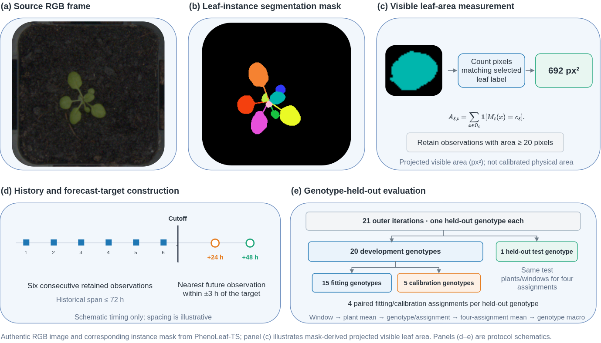
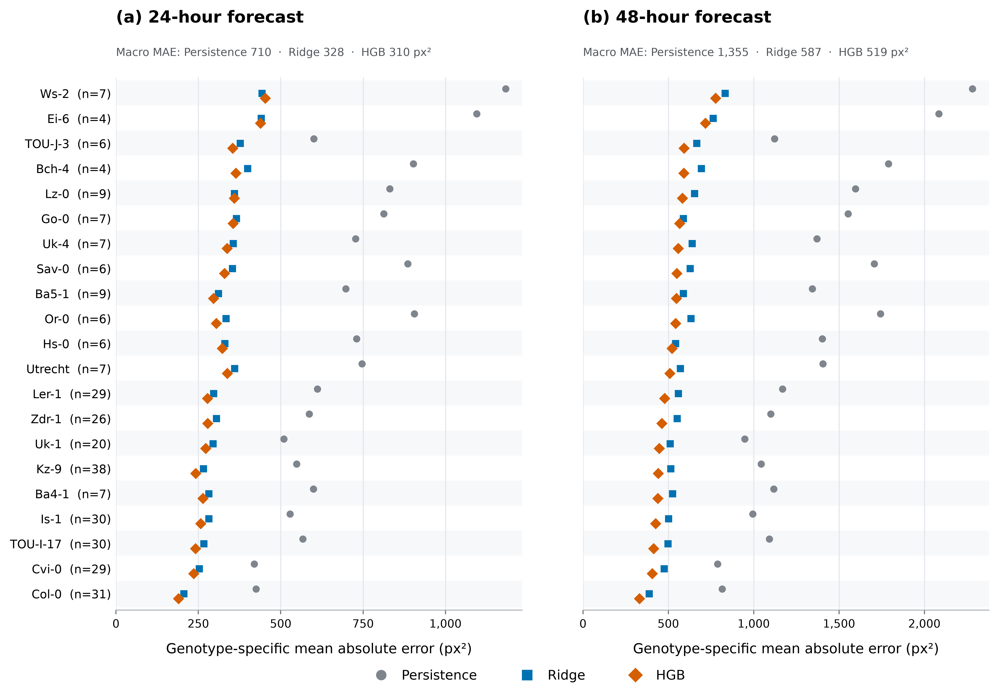
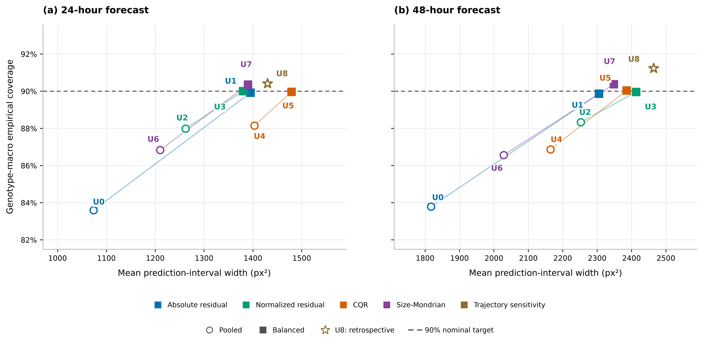
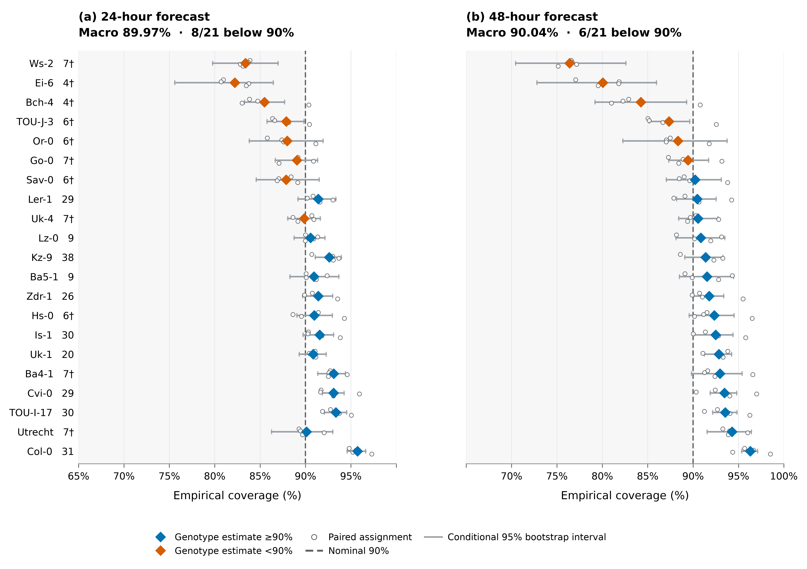
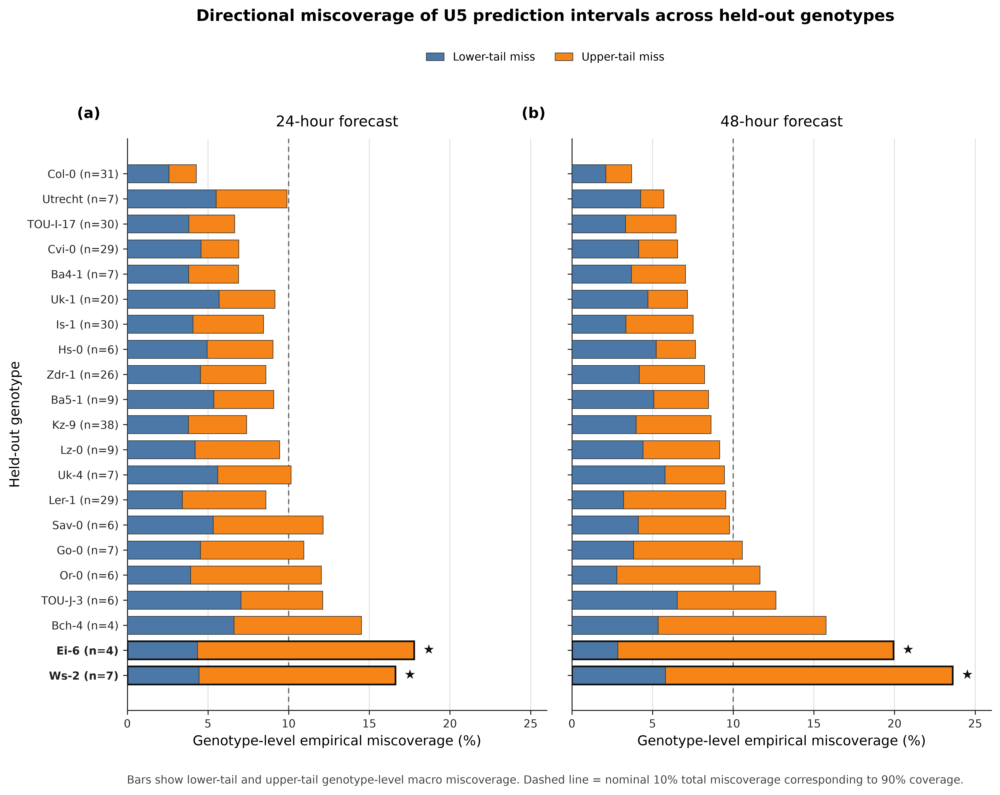
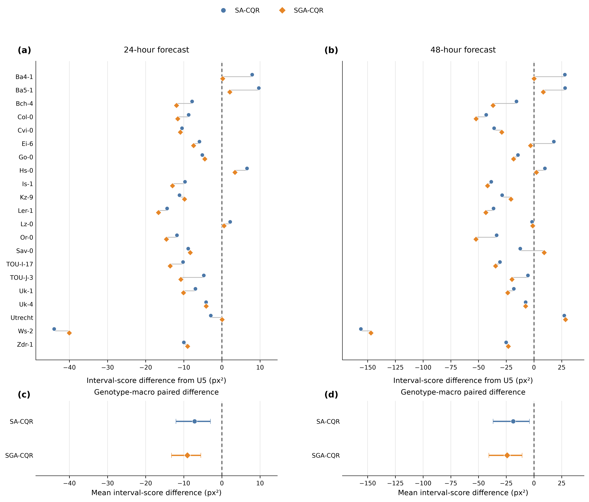

# LeafShift-CP

**Reliability of Conformal Prediction for Individual-Leaf Area Forecasting Under Held-Out Arabidopsis Genotypes**

Longitudinal plant phenotyping follows individual leaves as plants develop.
Forecasting their subsequent area can extend these observations from description
to prediction, but a useful forecast must also communicate uncertainty when
applied to genetic backgrounds absent from development. LeafShift-CP studies
**segmentation-derived projected visible leaf area in px²**. This image-derived
quantity reflects visibility and segmentation as well as growth; it is not
calibrated physical leaf surface area or biomass.

The study evaluates 24- and 48-hour prediction intervals using PhenoLeaf-TS
measurements from **21 *Arabidopsis* genotypes, 318 plants and 228,645 derived
forecasting windows**. Nine conformal procedures, U0–U8, are compared with the
test genotype excluded from both model fitting and calibration. Plant-balanced,
assignment-averaged and genotype-macro evaluation separates overall calibration
from the reliability experienced by a particular excluded genotype.

This reliability benchmark is followed by retrospective investigations of
replication, development assignments, temporal overlap, directional misses and
historical area-change dynamics. Paired adaptive CQR comparisons examine whether
historical information can improve interval efficiency without overstating the
scope of the evidence. The central empirical finding is that **near-90%
genotype-macro coverage coexists with markedly lower coverage for certain
excluded genotypes**.

## FORECASTING AND EVALUATION FRAMEWORK



① **Source observations.** PhenoLeaf-TS supplies longitudinal RGB images and
persistent leaf-instance masks. ② **Historical representation.** The original
pipeline extracts projected visible-area observations from the masks and forms
six-observation histories. Areas, relative observation times, adjacent changes,
change rates and historical summaries provide 29 predictors; identifiers and
future targets are excluded.

③ **Forecasting task.** Models estimate subsequent individual-leaf visible area
at nominal horizons of 24 and 48 hours. ④ **Genotype separation.** For interval
evaluation, each leave-one-genotype-out fold uses 15 fitting genotypes, five
separate calibration genotypes and one completely excluded test genotype.
Four paired development assignments change the fitting/calibration composition
while reusing the same held-out test plants and windows. Point-model selection
is evaluated through its separate genotype-held-out benchmark.

⑤ **Interval construction.** Conformal procedures use fitted mean or quantile
forecasts and disjoint calibration scores to construct nominal 90% prediction
intervals. ⑥ **Reliability evaluation.** Coverage, interval width and interval
score are averaged within plants, across assignments within genotype, and equally
across the held-out genotypes. Genotype-specific outcomes remain visible alongside
the macro summary.

Figure 1 combines original PhenoLeaf-TS RGB imagery and leaf-instance masks with
schematic panels of the documented experimental protocol. The derived windows
are repeated prediction opportunities, not independent biological replicates.
Dataset imagery is attributed to Sarić and colleagues; obtain original data from
the [official provider](https://huggingface.co/datasets/rick77a/PhenoLeaf_TS).
The unchanged figure is included under the
[confirmed permission scope](docs/DATA_AVAILABILITY.md), with both required
publications listed in [REFERENCES](#references).

## EXAMPLES AND EXPERIMENTAL RESULTS

### Example 1 — Individual-leaf forecasting

The point-forecasting benchmark compares persistence, Ridge regression and
histogram gradient boosting (HGB). Persistence carries the latest observed area
forward; Ridge provides a regularized linear predictor; HGB represents nonlinear
relationships among the historical features. Genotype-held-out testing evaluates
generalization to an unseen genetic background, with nested genotype-based model
selection for the fitted predictors.



HGB achieved genotype-macro mean absolute errors of **309.92 px² at 24 hours**
and **518.51 px² at 48 hours**. These
[archived point-model results](results/paper_tables/main/Table_02_Point_Forecasting_Baselines.csv)
describe forecasting accuracy, but accuracy alone does not establish whether
prediction intervals cover future observations reliably. The interval experiments
below use their own disjoint fitting/calibration protocol.

### Example 2 — Conformal prediction and coverage

The nine procedures compare how calibration scores and their empirical
representation affect uncertainty estimates. Pooled calibration gives every
window equal mass; genotype–plant-balanced calibration distributes mass equally
across genotypes and then plants, with windows sharing their plant's mass.
U0/U1 use absolute residuals, U2/U3 normalize residuals by historical size,
U4/U5 use conformalized quantile regression (CQR), and U6/U7 calibrate residuals
within historical-size Mondrian strata. In each pair, the first procedure is
pooled and the second balanced. U8 adds retrospective trajectory balancing within
plants as a sensitivity analysis.



Higher empirical coverage generally comes with wider intervals, so interval
score is used to assess width and miss penalties together. Balanced CQR, U5,
attained genotype-macro coverages of **89.97120%** and **90.04006%** at 24 and
48 hours. The [conformal performance table](results/paper_tables/main/Table_03_Conformal_Performance.csv)
preserves coverage, width and score for all U0–U8 procedures. Residual families
center intervals on mean predictions; CQR calibrates lower and upper quantile
predictions using the implemented nonnegative-expansion convention. Comparisons
across these families concern complete forecasting-and-calibration pipelines.



The macro average hides substantial heterogeneity: **eight of 21 genotypes at
24 hours and six of 21 at 48 hours** remained below the nominal 90% target.
The lowest observed genotype coverages were **82.217%** and **76.393%**,
respectively. Equal-weight averaging allows higher coverage in some genotypes
to offset deficits in others; it does not protect each excluded genotype.
The implemented empirical weighted quantiles do not establish a coverage
guarantee under arbitrary genotype shift.

### Example 3 — Understanding uncertainty failures

Genotype-specific diagnostics connect an aggregate reliability result to the
plants and observations behind it. [Development-assignment sensitivity](figures/main/F5_assignment_reliability.png)
examines changes in the fitting/calibration composition without introducing new
test plants. [Temporal thinning](figures/main/F6_nonoverlapping_window_sensitivity.png)
evaluates selected nonoverlapping forecast intervals using the existing U5
predictions and calibration; historical spans and biological clustering can
still overlap. Eleven genotypes had fewer than eight plants, making replication
an important limitation despite the large number of derived windows.



An upper-tail miss occurs when the observed future area exceeds the predicted
upper bound; a lower-tail miss occurs below the lower bound. At both horizons,
more targets exceeded the upper bound than fell below the lower bound,
indicating asymmetric undercoverage.

[Historical size and area-change associations](figures/main/Figure_F8_Growth_Size_Associations.png)
further characterize where these failures occur, including analyses within
coarse size strata. These are retrospective measurement-level associations.
They do not establish a physiological growth mechanism or biological causation:
orientation, overlap, occlusion and segmentation can also affect visible area.

### Example 4 — Adaptive conformal calibration

Size-adaptive CQR (SA-CQR) and size-and-growth-adaptive CQR (SGA-CQR) investigate
whether the calibration correction can respond to historical state. SA-CQR uses
historical leaf size; SGA-CQR additionally incorporates recent projected-area
change. Their comparison with U5 retains matched fitting, calibration and test
assignments and the base quantile-model comparison.



SGA-CQR reduced mean interval score relative to U5 by **9.049 px² at 24 hours**
and **24.133 px² at 48 hours** in the
[paired retrospective comparisons](experiments/P3/P3_7/P3_7_paired_summary.csv)
and [adaptive method summary](experiments/P3/P3_6/P3_6_method_summary.csv).
These are small empirical improvements, and worst-genotype undercoverage remains
unresolved. The extensions were investigated after earlier outer-test diagnostics;
the results do not establish independent validation or prospective superiority.

The experiments distinguish forecasting accuracy, aggregate calibration and
genotype-specific reliability. Average coverage or a modest score improvement
does not resolve the failures observed for particular excluded groups.
Supplementary evidence covers [growth associations (S1)](figures/supplementary/Figure_S1_Exploratory_Growth_Associations.png),
[interval width and biological scale (S2)](figures/supplementary/Figure_S2_Interval_Width_and_Leaf_Area.png),
[replication sensitivity (S3)](figures/supplementary/Figure_S3_Replication_Sensitivity.png)
and [incremental growth-adaptation value (S4)](figures/supplementary/Figure_S4_Growth_Incremental_Value.png).
The [figure/table map](docs/FIGURE_TABLE_MAP.csv) traces these publication assets
to their implementations and genuine archived numerical inputs.

## RUNNING THE TOOL

The research implementations are organized by experimental stage:
[src/E0/](src/E0/) contains dataset audits and leaf-area extraction;
[src/E1/](src/E1/) contains forecasting baselines;
[src/E2/](src/E2/) and [src/E3/](src/E3/) contain conformal experiments;
and [src/P0/](src/P0/), [src/P1/](src/P1/), [src/P2/](src/P2/) and
[src/P3/](src/P3/) contain statistical analyses, reliability diagnostics and
adaptive comparisons. [scripts/](scripts/) provides verification, planning and
supported reproduction entry points.

### Installation and immediate inspection

Use Python 3.12 and `uv` from the repository root:

```bash
uv venv .venv --python python3.12
uv pip install --python .venv/bin/python -r requirements.txt
```

The first command creates a local environment; the second installs the recorded
dependency versions. Then run:

```bash
.venv/bin/python scripts/verify.py
.venv/bin/python -m unittest discover -s tests -v
.venv/bin/python scripts/reproduce.py list
.venv/bin/python scripts/reproduce.py plan conformal
```

`verify.py` checks copied-source integrity, archived aggregates and protocol
rules. The tests check scientific imports, source syntax, feature construction
and safe workflow dispatch. `list` displays available workflow routes;
`plan conformal` reports required inputs and execution gates without fitting
models. These commands inspect the available repository evidence; they do not
perform full experimental reproduction.

### Research entry points

- [scripts/verify.py](scripts/verify.py) performs read-only source-copy and
  archived-result checks.
- [scripts/reproduce.py](scripts/reproduce.py) plans workflows or dispatches the
  original scripts into an isolated working copy, with explicit input and
  expensive-execution requirements.
- [scripts/generate_tables.py](scripts/generate_tables.py) re-aggregates genuine
  fold and genotype metrics into manuscript tables; it writes generated outputs.
- [src/E0/leaf_trajectory_audit.py](src/E0/leaf_trajectory_audit.py) extracts
  leaf-instance areas and trajectory observations from authorized source masks
  and the palette workbook.
- [src/E1/run_simple_baselines.py](src/E1/run_simple_baselines.py) evaluates
  persistence and the original time-aware linear-extrapolation baseline.
  [train_ridge_logo.py](src/E1/train_ridge_logo.py) and
  [train_boosting_logo.py](src/E1/train_boosting_logo.py) implement the fitted
  Ridge and HGB genotype-held-out benchmarks.
- [src/E2/run_conformal_baselines.py](src/E2/run_conformal_baselines.py) implements
  pooled and balanced residual calibration on the original primary split.
  [src/E3/run_cqr_baselines.py](src/E3/run_cqr_baselines.py) implements the CQR
  comparisons; the provenance map identifies the final archived experiment inputs.
- [src/P3/P3_2_directional_miscoverage.py](src/P3/P3_2_directional_miscoverage.py)
  computes directional summaries from U5 prediction-level archives, which are
  required inputs and are not bundled.
- [src/P3/P3_6_adaptive_cqr.py](src/P3/P3_6_adaptive_cqr.py) implements matched
  U5, SA-CQR and SGA-CQR experiments, with pilot and full modes.
  Execution requires the original generated data and calibration dependencies.

### Verification, replay and full reproduction

**1. Immediate verification** uses the bundled implementations and compact
archived evidence. It checks consistency and selected numerical results without
training models or generating figures.

**2. Supported replay** re-aggregates tables or reruns selected analyses and
numerical plots when their real required inputs are available. Historical records
cover table generation, selected P3 comparisons and 12 numerical figure replays;
these were not rerun for this README revision. Figure 1 is an unchanged manuscript
asset, not a numerical plotting output.

**3. Full experimental reproduction** requires an authorized external
PhenoLeaf-TS dataset, historical preprocessing, generated windows, model fitting
and calibration. Many original research scripts require files absent from the
public distribution. Workflow plans are useful for inspection but do not list
every implicit CSV dependency, and unit tests do not establish complete scientific
reproducibility.

See [REPRODUCIBILITY.md](docs/REPRODUCIBILITY.md) for evidence levels and supported
replay commands, [EXTERNAL_DATA_RECIPE.md](docs/EXTERNAL_DATA_RECIPE.md) for
external inputs and execution gates, and
[FIGURE_TABLE_MAP.csv](docs/FIGURE_TABLE_MAP.csv) for result-to-code traceability.

## ABOUT THIS PUBLIC RELEASE

This repository is a curated public release extracted from a larger private
research workspace. It preserves the original scientific implementations,
finalized configurations, authorized derived results and publication figures
while excluding restricted source datasets, intermediate development artifacts,
unnecessary duplicate artifacts and internal records. Scientific methods and
numerical results were not changed for public distribution. The public Git history is an organized
release history, not the complete chronology of the private development process.

The original raw dataset is not hosted here. Its exact historical archive
version/checksum was not retained, and the audited source inventory lacked
260 Ba4-1 RGB files. Full end-to-end extraction and training were not independently
reproduced during final public-release validation. These boundaries are retained
in the [dataset documentation](data/README.md) and
[reproducibility record](docs/REPRODUCIBILITY.md).

Original software is licensed under [MIT](LICENSE), with
`Copyright (c) 2026 Mouad el Baz, Sahil Khan`.
Dataset materials, derived-data files, figures and third-party dependencies have
separate rights; the software license does not automatically cover them.

## AUTHORS

**Mouad el Baz** — First author and sole corresponding author.

**Sahil Khan** — Second author.

**Qasim Khan** — Third author.

**Corresponding author**

Mouad el Baz<br>
Independent Researcher, Morocco<br>
Email: [elbaz.ouad1249@gmail.com](mailto:elbaz.ouad1249@gmail.com)<br>
ORCID: [0009-0005-0640-4166](https://orcid.org/0009-0005-0640-4166)

Use [CITATION.cff](CITATION.cff) to cite the code with all three scientific
authors, and identify the version used. The companion manuscript awaits
submission; no acceptance, journal publication or publication DOI is claimed
for the LeafShift-CP paper.

**Archived research software — v0.1.1**

[](https://doi.org/10.5281/zenodo.24370590)

Mouad el Baz, Sahil Khan, and Qasim Khan. *Reliability of Conformal Prediction
for Individual-Leaf Area Forecasting Under Held-Out Arabidopsis Genotypes*,
research software, version 0.1.1. Zenodo.
[DOI: 10.5281/zenodo.24370590](https://doi.org/10.5281/zenodo.24370590).
The archive corresponds to [GitHub release v0.1.1](https://github.com/moad-cod/LeafShift-CP/releases/tag/v0.1.1).
This is the software DOI; the journal manuscript has no publication DOI yet.
Later changes on `main` are post-release updates and do not alter that archive.

## REFERENCES

1. Sarić, R., Azam, B., Khan, S., and Čustović, E. (2026).
   *PhenoLeaf-TS: A Time-Series Benchmark for Leaf Instance Segmentation,
   Tracking, and Growth Stage Classification*. In *Computer Vision — ECCV 2026*,
   Lecture Notes in Computer Science, **17050**, pp. 407–424. Springer.
   [DOI: 10.1007/978-3-032-37359-5_23](https://doi.org/10.1007/978-3-032-37359-5_23).
2. Sarić, R., Kashkan, I., Lewsey, M. G., Panzarová, K., Trtílek, M.,
   Čustović, E., and Whelan, J. (2026).
   *ALeRT: An RGB-based deep learning pipeline and benchmark for automated
   phenotyping of rosette and leaf traits in Arabidopsis thaliana*.
   *Computers and Electronics in Agriculture*, article **112620**.
   [DOI: 10.1016/j.compag.2026.112620](https://doi.org/10.1016/j.compag.2026.112620).

Access the original dataset through the
[official PhenoLeaf-TS provider](https://huggingface.co/datasets/rick77a/PhenoLeaf_TS),
following its terms and citing both publications. The
[additional provider resource](https://arabidopsis-rgb.latrobe.edu.au) is
context/access information, not another established experimental input.
ALeRT provides RGB phenotyping context; use of its dataset or implementation in
these experiments is not asserted.

Mouad el Baz, the first author, obtained permission from the PhenoLeaf-TS dataset
corresponding author, Dr. Rijad Sarić, for the use of the specified research
materials and derived outputs. This includes the authorized original manuscript
Figure 1 and the numerical research outputs provided here. The original dataset
remains available from its provider. This permission does not grant unrestricted
redistribution of source RGB archives, segmentation masks or detailed
observation/window/leaf exports, which remain excluded. Private correspondence is
not published. See [data availability](docs/DATA_AVAILABILITY.md),
[permission scope](docs/FINAL_RELEASE_APPROVALS.md) and
[public exclusions](docs/PUBLIC_EXCLUSIONS.md).
